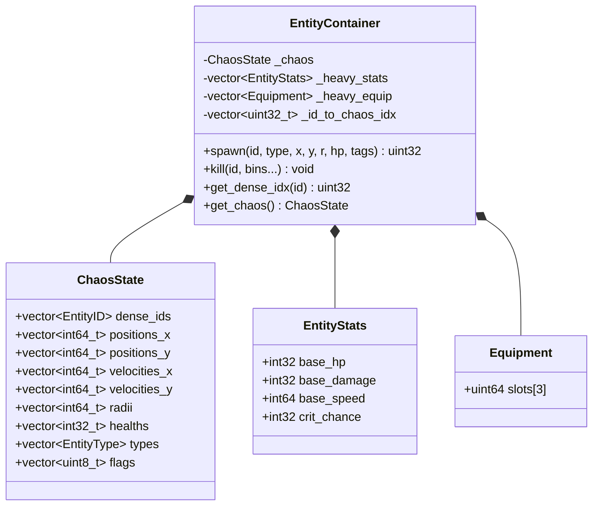
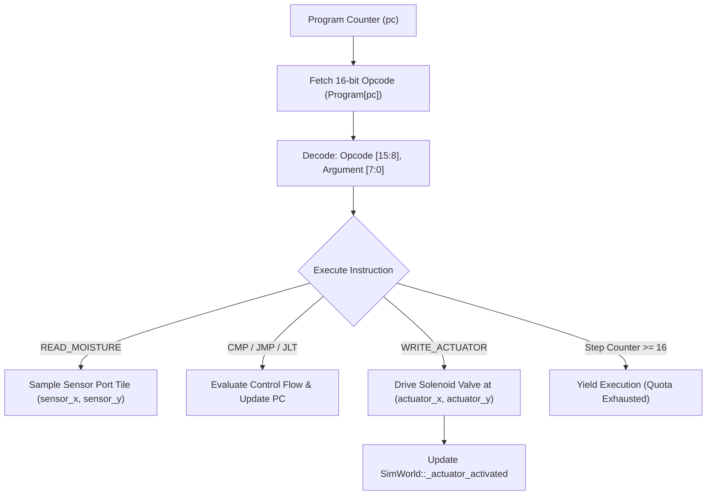

# ECS Architecture, Robotics & IoT Virtual Machine

This document details the data-oriented Entity Component System (SoA), mobile robotics, bytecode-driven IoT microcontroller virtual machine, and lockstep snapshot/rollback architecture in ExoFarm.

The core ECS and state containers are defined in [`src/core/ecs.h`](file:///E:/exofarm/exofarm/src/core/ecs.h) and [`src/core/entity.h`](file:///E:/exofarm/exofarm/src/core/entity.h). The bot navigation and VM interpreter are implemented in [`src/core/world.cpp`](file:///E:/exofarm/exofarm/src/core/world.cpp#L2176-L2415).

---

## 1. High-Performance Data-Oriented ECS

ExoFarm separates gameplay state into **Hot Data** (updated every tick by physics and collision) and **Cold/Heavy Data** (inspected only during combat damage calculation or equipment modification).



### 1.1 Structure-of-Arrays (SoA) Layout ([`ChaosState`](file:///E:/exofarm/exofarm/src/core/entity.h#L199-L263))
Rather than an array of polymorphic pointers (`std::vector<Entity*>`), hot data is packed into 13 parallel contiguous arrays:
- `positions_x`, `positions_y`: 16.16 fixed-point coordinates.
- `velocities_x`, `velocities_y`: 16.16 fixed-point momentum.
- `radii`, `frictions`: Collision geometry parameters.
- `healths`, `pierces`: Combat durability.
- `types`, `tags`, `flags`: Identification and state bitmasks.

#### Memory Performance Benefits:
1. **L1/L2 Cache Prefetching**: When integrating physics, the CPU streams `positions_x` and `velocities_x` directly through cache lines without fetching cold stats or strings.
2. **SIMD Vectorization**: Contiguous integer buffers map directly to AVX2/NEON vector instructions.
3. **Restricted Views**: [`ChaosState::get_restricted_view()`](file:///E:/exofarm/exofarm/src/core/entity.h#L252-L262) returns raw pointers tagged with `__restrict`, enabling the compiler to assume zero pointer aliasing and emit fused multiply-accumulate vector instructions.

### 1.2 Sparse-to-Dense Index Mapping & O(1) Removal
- `EntityID` values are 32-bit integers issued monotonically.
- [`_id_to_chaos_idx`](file:///E:/exofarm/exofarm/src/core/ecs.h#L217) is a sparse lookup vector.
- **Swap-and-Pop Removal** ([`EntityContainer::kill`](file:///E:/exofarm/exofarm/src/core/ecs.h#L103-L162)): When entity $E$ at index $i$ is killed:
  1. The last entity in the dense array $L$ is moved to index $i$.
  2. `_id_to_chaos_idx[L]` is updated to $i$.
  3. All SoA vectors `pop_back()`.
  4. `_id_to_chaos_idx[E]` is set to `0xFFFFFFFF`.
  Execution time is strictly $O(1)$, maintaining $100\%$ contiguous dense packing with zero memory fragmentation.

---

## 2. Mobile Robotics & Agricultural Automation

ExoFarm provides automated workforce entities governed by [`BotState`](file:///E:/exofarm/exofarm/src/core/entity.h#L89-L125):

### 2.1 Bot Chassis Types ([`BotType`](file:///E:/exofarm/exofarm/src/core/entity.h#L82-L87))
1. **`HUMANOID` (`0`)**: Versatile ground worker; base movement speed $1.0 \cdot \text{ONE}$.
2. **`DRONE` (`1`)**: High-speed aerial courier; moves at $4.0 \cdot \text{ONE}$, ignoring terrain drag.
3. **`COMBINE` (`2`)**: Heavy field machinery; moves at $2.0 \cdot \text{ONE}$ with high crop harvest throughput.
4. **`IOT_NODE` (`3`)**: Immobile field microcontroller; executes bytecode programs.

### 2.2 Task Dispatch & Pathing ([`world.cpp`](file:///E:/exofarm/exofarm/src/core/world.cpp#L2357-L2414))
Mobile bots receive commands specifying a target tile $(tx, ty)$ and job:
- **`PLANT` (`1`)**: Navigates to target tile; plants specified `seed_type` if ground is cleared.
- **`HARVEST` (`2`)**: Navigates to mature crop ($\text{growth} \ge 100\%$); triggers harvest and returns to idle.
- **`WATER` (`3`)**: Applies manual hydration to soil water table ($+30 \cdot \text{ONE}$).

Navigation applies fixed-point direction normalization and integrates velocity until the bot arrives within a 10-unit arrival tolerance circle.

---

## 3. The IoT Microcontroller Bytecode Virtual Machine

For programmable farm automation, stationary `IOT_NODE` bots run a lightweight, deterministic 16-bit virtual machine:



### 3.1 VM Architecture & Register File
- **Registers**: 4 general-purpose 32-bit registers (`R0`, `R1`, `R2`, `R3`).
- **Memory**: 32 instruction words (`uint16_t program[32]`).
- **Status Flag**: `cmp_result` ($-1$ for less-than, $0$ for equal, $+1$ for greater-than).
- **Instruction Quota**: Maximum **16 instructions executed per tick**. This guarantees determinism and prevents infinite loops from stalling the simulation.
- **I/O Ports**: Wired sensor coordinates $(sx, sy)$ and actuator coordinates $(ax, ay)$.

### 3.2 Instruction Set Architecture (ISA)

Each instruction is an unsigned 16-bit word: `[Opcode: 8 bits][Argument: 8 bits]`.

| Opcode | Mnemonic | Argument Encoding | Description |
| :---: | :--- | :--- | :--- |
| `0x00` | **`HALT`** | None | Stops program execution for the current tick. |
| `0x01` | **`LOAD`** | `[Reg: 2b][Val: 6b]` | Loads immediate integer literal into register: `R[reg] = val`. |
| `0x02` | **`READ_MOISTURE`** | `[Reg: 2b]` | Reads moisture level at `(sensor_x, sensor_y)` into register. |
| `0x03` | **`READ_CROP_GROWTH`** | `[Reg: 2b]` | Reads crop growth percentage at sensor tile into register. |
| `0x04` | **`WRITE_ACTUATOR`** | `[IsReg: 1b][Reg/Val: 7b]` | Drives actuator at `(actuator_x, actuator_y)`. Value $>0$ activates. |
| `0x05` | **`CMP`** | `[Reg: 2b][Val: 6b]` | Compares `R[reg]` with immediate literal; sets `cmp_result`. |
| `0x06` | **`JMP`** | `[Addr: 8b]` | Unconditional jump: `pc = addr`. |
| `0x07` | **`JLT`** | `[Addr: 8b]` | Jump if Less Than (`cmp_result < 0`): `pc = addr`. |
| `0x08` | **`JGT`** | `[Addr: 8b]` | Jump if Greater Than (`cmp_result > 0`): `pc = addr`. |
| `0x09` | **`ADD`** | `[Reg: 2b][Val: 6b]` | Arithmetic add immediate: `R[reg] += val`. |
| `0x0A` | **`SUB`** | `[Reg: 2b][Val: 6b]` | Arithmetic subtract immediate: `R[reg] -= val`. |

### 3.3 Example: Automated Soil Moisture Sprinkler Loop
The following assembly monitors soil moisture and triggers an irrigation actuator when moisture falls below $20\%$:

```asm
; --- Automated Irrigation Microcontroller Program ---
; Port Wiring: Sensor at (20, 20), Actuator at (21, 20)
0: READ_MOISTURE R0      ; Read soil water table % into R0
1: CMP R0, 20            ; Compare moisture against threshold 20%
2: JLT 6                 ; If moisture < 20%, jump to turn-on block (PC 6)
3: LOAD R1, 0            ; Otherwise load 0 into R1 (Off)
4: WRITE_ACTUATOR R1     ; Write 0 to sprinkler solenoid valve
5: JMP 8                 ; Jump to exit
6: LOAD R1, 1            ; Load 1 into R1 (On)
7: WRITE_ACTUATOR R1     ; Write 1 to sprinkler solenoid valve
8: HALT                  ; Terminate execution for this frame
```

---

## 4. Input Framing & Monotonic Replay Tape ([`input.h`](file:///E:/exofarm/exofarm/src/core/input.h))

All user actions and networked commands enter the simulation as discrete, tightly-packed binary [`InputFrame`](file:///E:/exofarm/exofarm/src/core/input.h#L6-L61) records:

```cpp
#pragma pack(push, 1)
struct InputFrame {
    enum class Kind : uint8_t {
        PlayerInput, EquipItem, UnequipItem, PlaceStructure,
        RemoveStructure, SpawnBot, SetBotJob, UploadBotProgram, WireBotPorts
    } kind;
    uint32_t tick; // Monotonic frame index

    union Payload {
        PlayerData      player;
        EventData       event;
        StructureData   structure;
        BotData         bot;
        BotProgramData  bot_program;
    } payload;
};
#pragma pack(pop)
```

Because frames contain zero pointer references, an entire gameplay session can be recorded simply by appending `InputFrame` instances to a flat disk file (`replay_tape.bin`).

---

## 5. Snapshot, Rollback & Determinism Verification

ExoFarm provides complete state serialization and rollback through [`BisectSnapshot`](file:///E:/exofarm/exofarm/src/core/entity.h#L266-L325).

### 5.1 State Hashing ([`SimWorld::get_state_hash`](file:///E:/exofarm/exofarm/src/core/world.cpp#L327-L467))
To verify lockstep synchronisation across networked peers or test runs without transmitting megabytes of state, the engine computes a 64-bit state hash combining:
- Monotonic tick and next Entity ID.
- PRNG seeds (`shotgun_seed`, `tornado_seed`, `crit_seed`).
- Entity SoA arrays (dense IDs, positions, velocities, health, flags).
- Complete farming grids (soil NPK, water table, crop growth, compactness).
- Hydrology graph state (reservoir volumes, river flow rates).
- Bot states (registers, program memory, PC).

If two runs produce different 64-bit hashes on the same tick, an out-of-sync divergence has occurred.

### 5.2 Standalone Headless Determinism Test ([`test_determinism.cpp`](file:///E:/exofarm/exofarm/test_determinism.cpp))
The engine includes a standalone validation executable that:
1. Generates a complex world with 200 enemies, 50 crops, structures, and automated bots.
2. Captures an initial snapshot.
3. Simulates 500 ticks while recording input frames and state hashes.
4. Restores the world to the initial snapshot.
5. Replays the recorded input tape tick-by-tick.
6. Verifies that every single replayed tick matches the reference hash with $100\%$ bit-for-bit equivalence.
