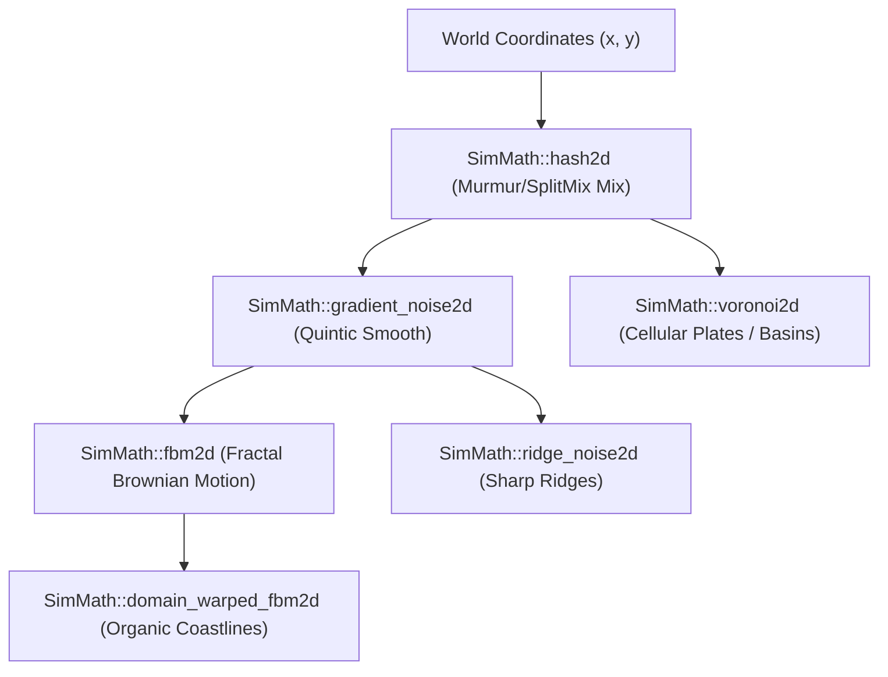

# Deterministic Mathematics Engine

This document provides a technical reference for the fixed-point mathematics, fast trigonometry, procedural noise, and bicubic interpolation routines used across the deterministic ExoFarm simulation core.

All simulation mathematics are located in [`src/math/`](file:///E:/exofarm/exofarm/src/math). To maintain strict 100% cross-platform determinism across x86_64, ARM, MSVC, Clang, and GCC, the simulation avoids IEEE 754 floating-point operations in core state progression, replacing them with integer-only arithmetic.

---

## 1. 16.16 Fixed-Point Arithmetic ([`fixed.h`](file:///E:/exofarm/exofarm/src/math/fixed.h))

The engine standardizes on **Q48.16 signed integer representation** stored in 64-bit integers (`int64_t`). The lower 16 bits represent the fractional component, providing a resolution of $1/65536 \approx 0.000015258789$, and the upper 48 bits represent the integer component (range: $\pm 140,737,488,355,327$).

### 1.1 Core Constants and Primitives

```cpp
static constexpr int64_t ONE          = 65536;   // 1.0 in 16.16
static constexpr int64_t PI_FIXED     = 205887;  // PI * 65536 (~3.14159265)
static constexpr int64_t HALF_PI      = 102944;  // (PI / 2) * 65536 (~1.5707963)
static constexpr int64_t TWO_PI       = 411775;  // (2 * PI) * 65536 (~6.2831853)
static constexpr int64_t K_FACTOR     = 39797;   // CORDIC gain correction * 65536 (~0.60725)
```

- [`mul_fixed(a, b)`](file:///E:/exofarm/exofarm/src/math/fixed.h#L17): Computes `(a * b) >> 16`. Because intermediate multiplication of two 16.16 values produces a 32.32 result, 64-bit storage prevents overflow as long as the absolute values are within $\approx 2^{31}$.
- [`div_fixed(a, b)`](file:///E:/exofarm/exofarm/src/math/fixed.h#L18): Computes `(a << 16) / b`.
- [`abs_fixed(a)`](file:///E:/exofarm/exofarm/src/math/fixed.h#L19), [`min_fixed(a, b)`](file:///E:/exofarm/exofarm/src/math/fixed.h#L20), [`max_fixed(a, b)`](file:///E:/exofarm/exofarm/src/math/fixed.h#L21): Branchless or fast comparisons.

### 1.2 Integer Square Root ([`sqrt_fixed`](file:///E:/exofarm/exofarm/src/math/fixed.h#L29-L59))

Standard floating-point `sqrt()` suffers from platform-specific rounding and compiler-level optimization differences (`-ffast-math`). ExoFarm uses a pure integer algorithm combining **binary search** with **Newton-Raphson refinement**:

1. **Binary Search**:
   Given input $x$ in 16.16 space ($x_{raw} = x \cdot 2^{16}$), we seek:
   $$\sqrt{x} = \sqrt{\frac{x_{raw}}{2^{16}}} = \frac{\sqrt{x_{raw}}}{2^8}$$
   In 16.16 output format, the integer representation must be:
   $$\text{result}_{raw} = \sqrt{x} \cdot 2^{16} = \sqrt{x_{raw}} \cdot 2^8$$
   The function tests candidate bits descending from $2^{23}$ down to $2^0$ to obtain $r = \lfloor\sqrt{x_{raw}}\rfloor$, then initialises $\text{res} = r \ll 8$.
2. **Newton-Raphson Iterations**:
   Two iterations refine fractional precision to sub-ULP accuracy:
   $$x_{n+1} = \frac{x_n + \frac{x}{x_n}}{2}$$

### 1.3 Integer Inverse Square Root ([`inv_sqrt_fixed`](file:///E:/exofarm/exofarm/src/math/fixed.h#L65-L82))

Used for normalizing 2D and 3D vectors without performing expensive division by square root:
$$\text{inv\_sqrt}(x) = \frac{1}{\sqrt{x}}$$
- Clamps values $x \le 64$ to avoid division by zero.
- Initial estimate obtained via `div_fixed(ONE, sqrt_fixed(x))`.
- Refined with 2 iterations of the Newton-Raphson inverse square root formula:
  $$x_{n+1} = \frac{x_n \cdot (3 - x \cdot x_n^2)}{2}$$

### 1.4 Geometric Primitives

- [`normalize_angle(angle)`](file:///E:/exofarm/exofarm/src/math/fixed.h#L84-L88): Normalizes an angle into $[-\pi, \pi]$ using fast modular increments of `TWO_PI`.
- [`point_to_segment_dist_sq(px, py, x1, y1, x2, y2)`](file:///E:/exofarm/exofarm/src/math/fixed.h#L91-L110): Finds the squared perpendicular distance from point $P$ to a line segment $AB$:
  $$t = \text{clamp}\left(\frac{(P - A) \cdot (B - A)}{|B - A|^2}, 0, 1\right)$$
  $$\text{dist}^2 = |P - (A + t(B - A))|^2$$

---

## 2. 3D Spatial Math & Fast Trigonometry ([`fixed_3d.h`](file:///E:/exofarm/exofarm/src/math/fixed_3d.h))

### 2.1 Bhaskara I Fast Rational Trigonometry

Rather than large lookup tables (which hurt L1 cache) or iterative CORDIC loops (which introduce branching latency), ExoFarm uses **Bhaskara I's 7th-century sine approximation formula**:

$$\sin(x) \approx \frac{16x(\pi - x)}{5\pi^2 - 4x(\pi - x)}, \quad x \in [0, \pi]$$

In 16.16 fixed-point:
- $5\pi^2 \approx 3,234,120$
- Maximum error is under $0.00163$ radians ($< 0.18\%$), while executing in just 4 multiplies, 1 division, and zero conditional branches in the inner loop.
- Cosine is evaluated using phase shifting: [`cos_fixed(x) = sin_fixed(x + HALF_PI)`](file:///E:/exofarm/exofarm/src/math/fixed_3d.h#L28-L30).

### 2.2 Vector & Quaternion Structures

#### [`Vec3Fixed`](file:///E:/exofarm/exofarm/src/math/fixed_3d.h#L34-L71)
Represents a 3D coordinate vector $(x, y, z)$ in 16.16 fixed point.
- **Dot product**: $v_1 \cdot v_2 = x_1 x_2 + y_1 y_2 + z_1 z_2$
- **Cross product**: $v_1 \times v_2 = (y_1 z_2 - z_1 y_2, z_1 x_2 - x_1 z_2, x_1 y_2 - y_1 x_2)$
- **Length & Normalization**: Computed via `sqrt_fixed(length_sq())` and `inv_sqrt_fixed()`.

#### [`QuatFixed`](file:///E:/exofarm/exofarm/src/math/fixed_3d.h#L75-L129)
Represents a rotation in 3D space using Hamilton quaternions $(x, y, z, w)$ with fixed-point coefficients ($w = \text{ONE}$ for identity).
- **Axis-Angle construction**: [`from_axis_angle(axis, angle)`](file:///E:/exofarm/exofarm/src/math/fixed_3d.h#L81-L93) uses `sin_fixed(angle / 2)` and `cos_fixed(angle / 2)`.
- **Hamilton Product**: Full non-commutative quaternion multiplication.
- **Vector Rotation**: [`rotate_vector(v)`](file:///E:/exofarm/exofarm/src/math/fixed_3d.h#L124-L128) evaluates $q \cdot v \cdot q^*$.

---

## 3. Coherent Procedural Noise Suite ([`noise.h`](file:///E:/exofarm/exofarm/src/math/noise.h))

Procedural world generation, biome distribution, tectonic warping, and moisture maps rely on a suite of fixed-point noise primitives in the `SimMath` namespace.



### 3.1 2D Integer Hash ([`hash2d`](file:///E:/exofarm/exofarm/src/math/noise.h#L10-L16))
Uses 64-bit integer mixing constants derived from MurmurHash3 and SplitMix to generate uniform pseudo-random 32-bit values for integer lattice points $(x, y)$:
```cpp
uint64_t h = seed ^ (static_cast<uint64_t>(x) * 0x1f1f1f1f1f1f1f1fULL)
                  ^ (static_cast<uint64_t>(y) * 0x517cc1b727220a95ULL);
h = (h ^ (h >> 30)) * 0xbf58476d1ce4e5b9ULL;
h = (h ^ (h >> 27)) * 0x94d049bb133111ebULL;
return static_cast<uint32_t>(h ^ (h >> 31));
```

### 3.2 Smoothing Polynomials
- **Quintic Smooth** ([`quintic_smooth`](file:///E:/exofarm/exofarm/src/math/noise.h#L20-L29)): Evaluates Perlin's 5th-order polynomial $6t^5 - 15t^4 + 10t^3$. First and second derivatives are zero at $t = 0$ and $t = 1$, preventing gradient discontinuities across cell boundaries.
- **Hermite Smooth** ([`hermite_smooth`](file:///E:/exofarm/exofarm/src/math/noise.h#L32-L38)): Evaluates the cubic smoothstep polynomial $3t^2 - 2t^3$.

### 3.3 Gradient Noise ([`gradient_noise2d`](file:///E:/exofarm/exofarm/src/math/noise.h#L41-L76))
Computes 2D value-gradient noise in $[-1, 1]$ fixed-point space using 8 predefined unit gradients `GRAD_X` and `GRAD_Y`. Lattice corners are interpolated with quintic smoothing weights.

### 3.4 Fractal Brownian Motion ([`fbm2d`](file:///E:/exofarm/exofarm/src/math/noise.h#L79-L102))
Accumulates multiple octaves of gradient noise:
$$\text{fBm}(p) = \sum_{i=0}^{N-1} \text{amp}_i \cdot \text{noise}(p \cdot \text{lacunarity}^i)$$
Default persistence is $0.5$ (`32768`) and lacunarity is $2.0$ (`131072`). Amplitude weights are normalized by `max_amp`.

### 3.5 Ridge Noise ([`ridge_noise2d`](file:///E:/exofarm/exofarm/src/math/noise.h#L105-L134))
Produces sharp mountain ridges for alpine terrain by inverting and squaring the absolute gradient signal:
$$\text{signal} = (1 - |\text{noise}|)^2$$
Successive octaves are weighted dynamically by the previous octave's signal, sharpening crests and flattening valleys.

### 3.6 Domain Warping ([`domain_warped_fbm2d`](file:///E:/exofarm/exofarm/src/math/noise.h#L137-L145))
Warping distorts coordinate space before sampling noise, breaking geometric lattice alignment and generating realistic fractal coastlines:
$$p' = p + \alpha \cdot \text{fBm}(p + \Delta)$$
$$\text{result} = \text{fBm}(p')$$

### 3.7 Cellular Voronoi Noise ([`voronoi2d`](file:///E:/exofarm/exofarm/src/math/noise.h#L148-L189))
Evaluates the 9-neighborhood of cells around $(x, y)$, jittering cell feature points using `hash2d`. Returns [`VoronoiResult`](file:///E:/exofarm/exofarm/src/math/noise.h#L148-L153):
- `dist_sq`: Squared distance to closest cell centroid.
- `cell_x`, `cell_y`: Lattice coordinates of the closest cell.
- `cell_id`: Unique 32-bit hash identifying the cell region.

---

## 4. Random Number Generator ([`rng.h`](file:///E:/exofarm/exofarm/src/math/rng.h))

The engine utilizes [`SplitMix64`](file:///E:/exofarm/exofarm/src/math/rng.h#L5-L24), a fast, non-cryptographic pseudo-random number generator with a 64-bit state. It has a period of $2^{64}$ and passes the BigCrush test suite:

```cpp
uint64_t next() {
    uint64_t z = (state += 0x9e3779b97f4a7c15ULL);
    z = (z ^ (z >> 30)) * 0xbf58476d1ce4e5b9ULL;
    z = (z ^ (z >> 27)) * 0x94d049bb133111ebULL;
    return z ^ (z >> 31);
}
```

The master simulation tick uses isolated PRNG streams for different systems (e.g. `_rng_shotgun`, `_rng_tornado`, `_rng_crit`) by branching off seeds with fixed tick offsets, preventing one system's random draws from desynchronizing another.

---

## 5. Bicubic & Spline Surface Interpolation ([`bicubic.h`](file:///E:/exofarm/exofarm/src/math/bicubic.h))

To evaluate smooth terrain elevations, gradients, and slope vectors from discrete simulation grid points, `SimMath` implements Catmull-Rom cubic splines:

### 5.1 1D Catmull-Rom Spline ([`cubic_catmull_rom`](file:///E:/exofarm/exofarm/src/math/bicubic.h#L12-L26))
Interpolates between control points $p_1$ and $p_2$ using adjacent points $p_0$ and $p_3$ for $t \in [0, 1]$ with continuous $C^1$ first derivatives. Evaluated via Horner's method:
$$c_3 = -p_0 + 3p_1 - 3p_2 + p_3$$
$$c_2 = 2p_0 - 5p_1 + 4p_2 - p_3$$
$$c_1 = -p_0 + p_2$$
$$c_0 = 2p_1$$
$$\text{val} = \frac{((c_3 t + c_2) t + c_1) t + c_0}{2}$$

### 5.2 1D Derivative Evaluation ([`cubic_derivative`](file:///E:/exofarm/exofarm/src/math/bicubic.h#L29-L40))
Computes $\frac{df}{dt}$ analytically:
$$\frac{df}{dt} = \frac{3 c_3 t^2 + 2 c_2 t + c_1}{2}$$

### 5.3 2D Bicubic Surface & Gradient Sampling
- [`bicubic_sample_2d(...)`](file:///E:/exofarm/exofarm/src/math/bicubic.h#L46-L88): Evaluates a $4 \times 4$ grid of control nodes around $(x, y)$ using 4 horizontal Catmull-Rom passes followed by 1 vertical Catmull-Rom pass.
- [`bicubic_gradient_2d(...)`](file:///E:/exofarm/exofarm/src/math/bicubic.h#L91-L149): Computes directional derivatives $\left(\frac{\partial H}{\partial x}, \frac{\partial H}{\partial y}\right)$ analytically across the bicubic patch.
- [`bicubic_slope_2d(...)`](file:///E:/exofarm/exofarm/src/math/bicubic.h#L151-L157): Computes total slope magnitude:
  $$\text{slope} = \sqrt{\left(\frac{\partial H}{\partial x}\right)^2 + \left(\frac{\partial H}{\partial y}\right)^2}$$
