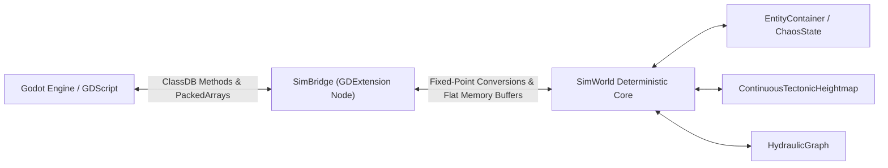
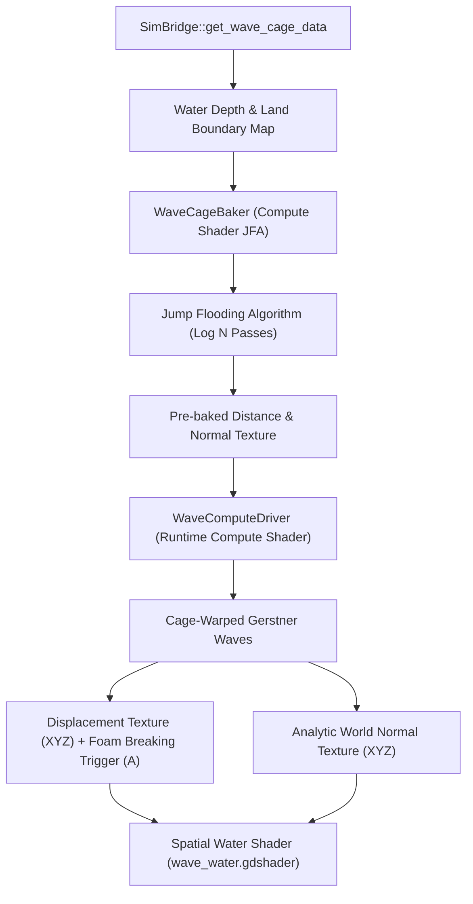

# GDExtension Integration, GPU Wave Cages & Visualizers

This document details the Godot 4.x GDExtension binding interface, zero-copy buffer marshaling, GPU compute-driven boundary-aware wave cage simulation (Jeschke et al. 2020), and frontend debug visualizers.

The GDExtension bridge layer is located in [`src/gdextension/`](file:///E:/exofarm/exofarm/src/gdextension). GPU compute and water shaders are located in [`assets/shaders/`](file:///E:/exofarm/exofarm/assets/shaders).

---

## 1. GDExtension Bridge Architecture

ExoFarm isolates simulation logic completely from the Godot rendering engine. The simulation core has zero knowledge of `godot::Node`, `godot::Vector3`, or scenes. All interactions flow through a dedicated bridge class, [`SimBridge`](file:///E:/exofarm/exofarm/src/gdextension/sim_bridge.h).

### 1.1 Module Entry Point ([`register_types.cpp`](file:///E:/exofarm/exofarm/src/gdextension/register_types.cpp))
The shared library (`libmecha_arpg.dll`) registers itself via `mecha_arpg_library_init`:
- Hooks into `MODULE_INITIALIZATION_LEVEL_SCENE`.
- Registers `SimBridge` with Godot's runtime reflection database via `GDREGISTER_CLASS(SimBridge)`.

### 1.2 Translation Layer Design
[`SimBridge`](file:///E:/exofarm/exofarm/src/gdextension/sim_bridge.h#L14-L138) provides strict conversion between Godot variants and simulation types:
- **Floating-point inputs** from GDScript (e.g. mouse aim or velocities) are shifted into 16.16 fixed-point space (`val * 65536.0`).
- **Simulation state outputs** are converted into Godot `PackedByteArray`, `PackedInt32Array`, `PackedInt64Array`, or `PackedFloat64Array`.
- **Zero-Copy Batch Rendering** ([`SimBridge::get_render_states`](file:///E:/exofarm/exofarm/src/gdextension/sim_bridge.cpp#L485-L515)): Rather than returning an array of thousands of Godot Dictionary objects (which causes severe heap allocation thrashing), `get_render_states` returns a single flat `PackedFloat64Array` containing contiguous tuples of:
  $$[\text{id}, x, y, \text{vel}_x, \text{vel}_y, \text{radius}, \text{health}, \text{flags}, \text{type}]$$
  The GDScript renderer passes this buffer directly to GPU multi-mesh instances.

---

## 2. Boundary-Aware Wave Cages (Jeschke et al. 2020)

For high-fidelity coastal water simulation without expensive 3D Navier-Stokes volume solvers, ExoFarm implements the state-of-the-art method described in:
> **"Water Surface Animation with Boundary-Aware Wave Cages"**  
> *Stefan Jeschke, Chris Wojtan (ACM Transactions on Graphics / SIGGRAPH Asia 2020)*

### 2.1 Wave Cage Extraction ([`SimBridge::get_wave_cage_data`](file:///E:/exofarm/exofarm/src/gdextension/sim_bridge.cpp#L790-L835))
Returns a 4-channel float array `(R, G, B, A)` for each map cell:
- **R**: Water depth $\max(0.0, \text{sea\_level} - \text{elevation})$.
- **G**: Boundary indicator ($1.0$ if land/obstacle, $0.0$ if water).
- **B, A**: Reserved for directional boundary flows.

### 2.2 GPU Jump Flooding Baker ([`wave_cage_baker.gd`](file:///E:/exofarm/exofarm/assets/shaders/wave_cage_baker.gd), [`wave_cage_baker.glsl`](file:///E:/exofarm/exofarm/assets/shaders/wave_cage_baker.glsl))
Offloads multi-source Euclidean distance transforms to the GPU:
- Employs the **Jump Flooding Algorithm (JFA)** across $\log_2(N)$ passes with descending step lengths ($256, 128, 64, \dots, 1$).
- Calculates the nearest shoreline contact point, distance to land, and coastal normal vector for every ocean cell in milliseconds without CPU frame stutter.

### 2.3 Real-Time Wave Compute Driver ([`wave_compute_driver.gd`](file:///E:/exofarm/exofarm/assets/shaders/wave_compute_driver.gd))
Executes each frame on the GPU RenderingDevice:
- Warps Gerstner wave propagation vectors along coastal boundaries using the pre-baked distance field.
- Ensures waves naturally align parallel to beaches and dissipate before penetrating dry land.
- Writes out two rendering textures:
  1. `displacement_tex`: RGB = world displacement $(dx, dy, dz)$, A = vertical acceleration breaking trigger $[0, 1]$.
  2. `normal_tex`: RGB = analytic Gerstner surface normal vector.

### 2.4 Water Surface Shader ([`wave_water.gdshader`](file:///E:/exofarm/exofarm/assets/shaders/wave_water.gdshader))
- **Vertex function**: Displaces 3D water mesh vertices according to `displacement_tex.xyz`. Because wave cages enforce zero amplitude at shorelines, vertices naturally taper without sawtooth clipping.
- **Fragment function**: Transforms analytic world normals into view space. Automatically blends white foam (`foam_color`) where the breaking trigger exceeds $0.5$.

---

## 3. Frontend Diagnostic Visualizers

The codebase provides three complete graphical visualizer scenes in Godot:

### 3.1 3D Continuous World Visualizer ([`world_3d_visualizer.gd`](file:///E:/exofarm/exofarm/world_3d_visualizer.gd))
- **Interactive Orbit Camera**: Free 3D orbit, pan, and zoom controls.
- **Dynamic Terrain Meshing**: Generates a continuous 3D triangle mesh from fixed-point heightfield data.
- **Tectonic Vector Gizmos**: Renders drift velocity arrows and boundary hyperplanes for active lithospheric plates in 3D space.
- **Real-Time Ocean Simulation**: Couples the GPU wave driver and water shader with interactive sea level and wave amplitude controls.
- **Debug Configuration Persistence**: Automatically saves and loads all world generation parameters, camera orbit target, and visualizer display toggles to/from [`world_3d_config.json`](file:///E:/exofarm/exofarm/world_3d_config.json) during debug runs (supports UI buttons and `Ctrl+S` / `Ctrl+L` shortcuts).

### 3.2 Continental Tectonic Map Visualizer ([`map_gen_visualizer.gd`](file:///E:/exofarm/exofarm/map_gen_visualizer.gd))
Provides 5 specialized visualization modes:
1. **Micro Surface**: Ground terrain art (dry soil, mud banks, stone, minerals).
2. **Macro Biomes**: Continental color-coded Whittaker biome distribution.
3. **Minerals**: Factorio-style resource deposits (Silica, Iron, Copper, Limestone, Coal, Sulfur, Granite).
4. **Heightmap Elevation**: Grayscale hypsometric elevation tinting.
5. **Hydrology & Water Table**: Groundwater saturation contours and flow directions.

### 3.3 Micro River & Ground Visualizer ([`river_micro_visualizer.gd`](file:///E:/exofarm/exofarm/river_micro_visualizer.gd))
A specialized tool for verifying river topology:
- **D8 Flow Direction Arrows**: Overlays downhill hydraulic gradients.
- **Pipe Reach Coloring**: Visualizes individual `RiverBelt` reach IDs and confluences.
- **River Health & Drought Heatmap**: Displays pipe water level percentages ($0\%$ to $100\%$) to test pump extraction parasitism and downstream dry-up cascades.
- **Collision & Passability**: Highlights walkable bridges, wading shallows, and impassable cliffs.
