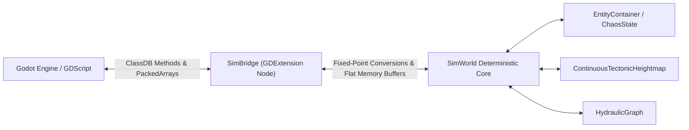
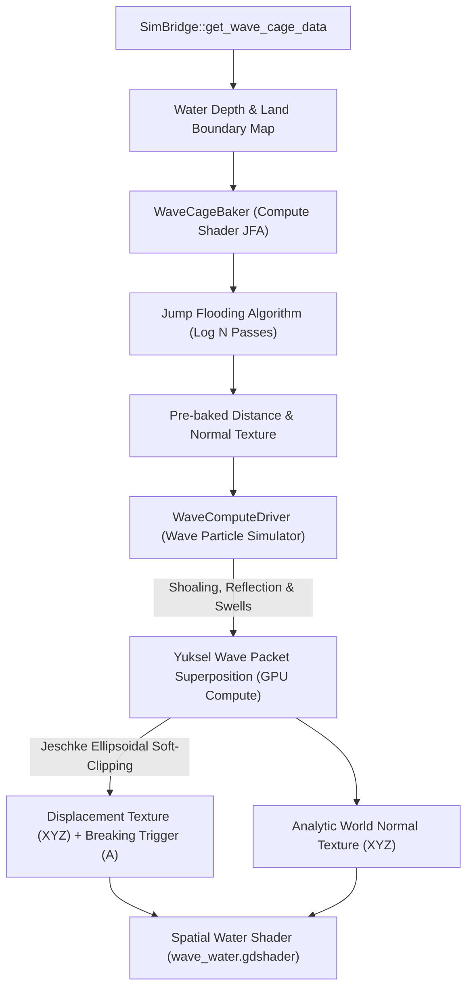

# GDExtension Integration, GPU Wave Cages & Visualizers

This document details the Godot 4.x GDExtension binding interface, zero-copy buffer marshaling, GPU compute-driven boundary-aware wave cage simulation (Jeschke et al. 2020), and frontend debug visualizers.

The GDExtension bridge layer is located in [`src/gdextension/`](file:///E:/exofarm/exofarm/src/gdextension). GPU compute and water shaders are located in [`assets/shaders/`](file:///E:/exofarm/exofarm/assets/shaders).

---

## 1. GDExtension Bridge Architecture

ExoFarm isolates simulation logic completely from the Godot rendering engine. The simulation core has zero knowledge of `godot::Node`, `godot::Vector3`, or scenes. All interactions flow through a dedicated bridge class, [`SimBridge`](file:///E:/exofarm/exofarm/src/gdextension/sim_bridge.h).

### 1.1 Module Entry Point ([`register_types.cpp`](file:///E:/exofarm/exofarm/src/gdextension/register_types.cpp))
The shared library (`libexofarm.dll`) registers itself via `exofarm_library_init`:
- Hooks into `MODULE_INITIALIZATION_LEVEL_SCENE`.
- Registers `SimBridge` and `BotanicalTreeBridge` with Godot's runtime reflection database.

### 1.2 Translation Layer Design
[`SimBridge`](file:///E:/exofarm/exofarm/src/gdextension/sim_bridge.h#L14-L138) provides strict conversion between Godot variants and simulation types:
- **Floating-point inputs** from GDScript (e.g. mouse aim or velocities) are shifted into 16.16 fixed-point space (`val * 65536.0`).
- **Simulation state outputs** are converted into Godot `PackedByteArray`, `PackedInt32Array`, `PackedInt64Array`, or `PackedFloat64Array`.
- **Zero-Copy Batch Rendering** ([`SimBridge::get_render_states`](file:///E:/exofarm/exofarm/src/gdextension/sim_bridge.cpp#L485-L515)): Rather than returning an array of thousands of Godot Dictionary objects (which causes severe heap allocation thrashing), `get_render_states` returns a single flat `PackedFloat64Array` containing contiguous tuples of:
  $$[\text{id}, x, y, \text{vel}_x, \text{vel}_y, \text{radius}, \text{health}, \text{flags}, \text{type}]$$
  The GDScript renderer passes this buffer directly to GPU multi-mesh instances.

---

## 2. Boundary-Aware Wave Particles & Wave Cages (Yuksel 2007 + Jeschke 2020)

For high-fidelity coastal water simulation and interactive wave dynamics without expensive 3D Navier-Stokes volume solvers, ExoFarm couples two seminal methods in computer graphics:
> **"Wave Particles"**  
> *Cem Yuksel, Donald H. House, John Keyser (ACM Transactions on Graphics / SIGGRAPH 2007)*  
> **"Water Surface Animation with Boundary-Aware Wave Cages"**  
> *Stefan Jeschke, Chris Wojtan (ACM Transactions on Graphics / SIGGRAPH Asia 2020)*

### 2.1 Wave Cage Extraction & Estuary Transition ([`SimBridge::get_wave_cage_data`](file:///E:/exofarm/exofarm/src/gdextension/sim_bridge.cpp#L956-L1010))
Returns a 4-channel float array `(R, G, B, A)` for each map cell, coupling ocean wave caging with continuous fluvial hydrology:
- **R**: Physical elevation in meters $H$ (sea level datum = $0.0\text{m}$).
- **G**: Boundary & Estuary Damping Mask ($1.0$ for dry land and inland carved river channels; $0.0$ for open ocean). Pinned as a Dirichlet boundary in the JFA baker so ocean wave cages enforce zero amplitude inside inland river channels.
- **B, A**: River outflow plume velocity vector $(V_x, V_y)$ in $\text{m/s}$ discharging into the sea from estuary mouths. Drives wave-current interaction (Doppler deceleration, wave steepening, and breaking whitecaps over the estuary bar).

### 2.2 GPU Jump Flooding Baker ([`wave_cage_baker.gd`](file:///E:/exofarm/exofarm/assets/shaders/wave_cage_baker.gd), [`wave_cage_baker.glsl`](file:///E:/exofarm/exofarm/assets/shaders/wave_cage_baker.glsl))
Offloads multi-source Euclidean distance transforms to the GPU:
- Employs the **Jump Flooding Algorithm (JFA)** across $\log_2(N)$ passes with descending step lengths ($256, 128, 64, \dots, 1$).
- Calculates the nearest shoreline contact point, distance to land, and coastal normal vector for every ocean cell in milliseconds without CPU frame stutter.

### 2.3 Real-Time Wave Particle Driver ([`wave_compute_driver.gd`](file:///E:/exofarm/exofarm/assets/shaders/wave_compute_driver.gd), [`wave_compute.glsl`](file:///E:/exofarm/exofarm/assets/shaders/wave_compute.glsl))
Simulates up to 512 discrete 2D wave packet particles on the GPU:
- **Yuksel Wave Packet Superposition**: Each particle carries position, direction, speed, amplitude, kernel radius, and carrier wavelength with a smooth Hann window envelope $\Pi(u) = \frac{1}{2}(\cos(\pi u) + 1)$ and Gerstner-style horizontal trochoidal sharpening.
- **Physical Shoaling & Coastal Refraction**: Waves naturally decelerate in shallow water ($s \propto \sqrt{g H}$) and refract toward the coast.
- **Specular Coastal Reflection**: When wave packets approach shorelines within kernel radius distance, they specularly bounce off the coastal normal $\hat{n}_{\text{shore}}$, creating realistic reflected wakes and interference patterns.
- **Interactive Disturbance Ripples**: Clicking on the ocean with LMB or pressing `[E]` spawns circular expanding ripple bursts that travel across the sea and reflect off islands and cliffs.
- **Jeschke Ellipsoidal Cage Warping**: Evaluated wave particle displacements pass through the Jeschke ellipsoidal soft-clipping cage, strictly preventing wave penetration onto dry land.
- Writes out two rendering textures:
  1. `displacement_tex`: RGB = world displacement $(dx, dy, dz)$, A = vertical acceleration breaking trigger $[0, 1]$.
  2. `normal_tex`: RGB = analytic surface normal vector.

### 2.4 Water Surface Shader ([`wave_water.gdshader`](file:///E:/exofarm/exofarm/assets/shaders/wave_water.gdshader))
- **Vertex function**: Displaces 3D water mesh vertices according to `displacement_tex.xyz`. Because wave cages enforce zero amplitude at shorelines, vertices naturally taper without sawtooth clipping.
- **Fragment function**:
  - **Beer-Lambert Light Absorption**: Computes true linear water depth $\Delta z$ via view-space depth reconstruction (`hint_depth_texture`), smoothly attenuating light from shallow tropical turquoise to abyssal oceanic navy.
  - **Artifact-Free Refraction**: Samples `hint_screen_texture` distorted by surface normals, with boundary-clipping protection at coastlines.
  - **Dual-Octave Micro-Ripples & Sun Glitter**: Combines counter-drifting procedural micro-wave ripples with the Gerstner swell normal to capture brilliant specular sun sparkle and Schlick Fresnel reflections.
  - **Shallow Seabed Caustics & SSS**: Renders animated caustic light patterns in shallows and backlit emerald wave translucency (subsurface scattering).
  - **Pristine Physical Water Surface**: Rendered with high-gloss PBR response (roughness 0.04, specular 0.85) without artificial foaming noise or opaque white blotches.

### 2.5 3D Continuous Terrain Shader ([`world_terrain_3d.gdshader`](file:///E:/exofarm/exofarm/assets/shaders/world_terrain_3d.gdshader))
- **Slope-Aware Triplanar Rock Strata**: Automatically transitions steep slopes ($\text{slope} > 35^\circ$) into rugged cliff faces featuring horizontal geological sedimentary/metamorphic strata bands and vertical fissure erosion.
- **Organic Whittaker Biome Synthesis**: Procedurally blends biomes (Tundra permafrost, Desert dunes, Grasslands, Temperate Forest, Jungle Rainforest, and Peat Swamps) with natural micro-noise boundaries.
- **Slope-Slipping Glacial Snow Peaks**: Generates snow caps on high alpine elevations, with physical slope awareness where snow naturally slides off vertical rock crags and clings only to flatter ledges and plateaus.
- **Dynamic Wet-Sand Shoreline**: Darkens albedo and increases specular gloss within the wave-wash boundary near sea level.
- **Procedural Micro-Relief Bump Normals**: Perturbs surface normals with analytical fBm derivatives, casting crisp micro-shadows under directional sunlight.

---

## 3. Frontend Diagnostic Visualizers

The codebase provides three complete graphical visualizer scenes in Godot:

### 3.1 3D Continuous World Visualizer ([`world_3d_visualizer.gd`](file:///E:/exofarm/exofarm/scenes/visualizers/world_3d_visualizer.gd))
- **Interactive Orbit Camera**: Free 3D orbit, pan, and zoom controls.
- **Dynamic Terrain Meshing & PBR Shading**: Couples continuous 3D triangle meshing with [`world_terrain_3d.gdshader`](file:///E:/exofarm/exofarm/assets/shaders/world_terrain_3d.gdshader) for slope-aware rock strata and biome transitions.
- **Procedural Atmospheric Sky & Fog**: Features `ProceduralSkyMaterial`, ACES filmic tonemapping, directional sun cascaded shadow mapping, and aerial perspective depth fog.
- **Tectonic Vector Gizmos**: Renders drift velocity arrows and boundary hyperplanes for active lithospheric plates in 3D space.
- **Real-Time Ocean Simulation**: Couples the GPU wave driver with [`wave_water.gdshader`](file:///E:/exofarm/exofarm/assets/shaders/wave_water.gdshader) for boundary-aware wave particles, caustics, and subsurface scattering.
- **Interactive Shader Fidelity Knobs**: Real-time UI sliders for water clarity, micro-wave glints, cliff rock slope, snow elevation, and atmospheric fog density.
- **Debug Configuration Persistence**: Automatically saves and loads all world generation parameters, camera orbit target, visualizer display toggles, and shader fidelity knobs to/from [`world_3d_config.json`](file:///E:/exofarm/exofarm/world_3d_config.json) during debug runs (supports UI buttons and `Ctrl+S` / `Ctrl+L` shortcuts).

### 3.2 Continental Tectonic Map Visualizer ([`map_gen_visualizer.gd`](file:///E:/exofarm/exofarm/scenes/visualizers/map_gen_visualizer.gd))
Provides 5 specialized visualization modes:
1. **Micro Surface**: Ground terrain art (dry soil, mud banks, stone, minerals).
2. **Macro Biomes**: Continental color-coded Whittaker biome distribution.
3. **Minerals**: Factorio-style resource deposits (Silica, Iron, Copper, Limestone, Coal, Sulfur, Granite).
4. **Heightmap Elevation**: Grayscale hypsometric elevation tinting.
5. **Hydrology & Water Table**: Groundwater saturation contours and flow directions.

### 3.3 Micro River & Ground Visualizer ([`river_micro_visualizer.gd`](file:///E:/exofarm/exofarm/scenes/visualizers/river_micro_visualizer.gd))
A specialized tool for verifying river topology:
- **D8 Flow Direction Arrows**: Overlays downhill hydraulic gradients.
- **Pipe Reach Coloring**: Visualizes individual `RiverBelt` reach IDs and confluences.
- **River Health & Drought Heatmap**: Displays pipe water level percentages ($0\%$ to $100\%$) to test pump extraction parasitism and downstream dry-up cascades.
- **Collision & Passability**: Highlights walkable bridges, wading shallows, and impassable cliffs.
