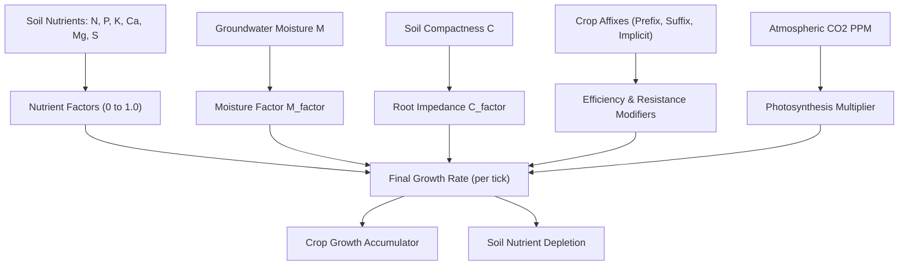
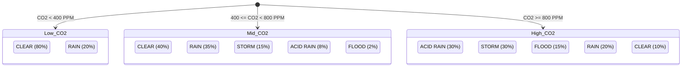

# Hydrology, Agronomy & Environmental Simulation

This document provides a technical specification for the closed-loop hydraulic network, 6-nutrient soil chemistry, crop genetics and affixes, irrigation infrastructure, and atmospheric weather cycles in ExoFarm.

All hydrology graph algorithms reside in [`src/core/hydrology_graph.h`](file:///E:/exofarm/exofarm/src/core/hydrology_graph.h). Crop life cycles, soil dynamics, irrigation relaxation, and climate interactions are simulated in [`src/core/world.cpp`](file:///E:/exofarm/exofarm/src/core/world.cpp#L1271-L2154).

---

## 1. Closed-Loop Hydraulic Graph Network ([`hydrology_graph.h`](file:///E:/exofarm/exofarm/src/core/hydrology_graph.h))

Surface water in ExoFarm is modeled as a directed acyclic flow graph consisting of **Reservoir Nodes** (lakes, ponds, aquifers, oceans) interconnected by **River Belts** (conduits/reaches):

```mermaid
flowchart LR
    A["Headwater Spring"] -->|River Belt Tier 1| B["Confluence Reach Tier 2"]
    C["Lake Reservoir"] -->|River Belt Tier 1| B
    B -->|River Belt Tier 3 (Trunk)| D["Terminal Ocean / Lake Sink"]
    E["Active Pump Structure"] -.->|Parasitizes Flow| B
```

### 1.1 Data Structures

#### [`ReservoirNode`](file:///E:/exofarm/exofarm/src/core/hydrology_graph.h#L13-L34)
Represents a lumped body of stored water:
- `current_volume`: Current volume stored in 16.16 fixed-point units.
- `max_capacity`: Maximum holding capacity.
- `water_level`: Ratio $\frac{\text{volume}}{\text{capacity}} \times 100\%$ ($0$ to $100 \cdot \text{ONE}$).
- `is_infinite`: Flag for the global ocean (infinite water source/sink).
- `extraction_rate`: Total rate drawn per tick by pumps placed on its tiles.
- `tile_indices`: Spatial footprint of grid tiles belonging to this reservoir.

#### [`RiverBelt`](file:///E:/exofarm/exofarm/src/core/hydrology_graph.h#L36-L60)
Represents a continuous segment (reach) of river tiles:
- `tier`: 1 = Brook (Spring to Confluence), 2 = River (Confluence reach), 3 = Trunk River.
- `from_node`, `to_node`: Upstream and downstream reservoir IDs ($0$ if headwaters or ocean).
- `upstream_belt_ids`: IDs of all tributary reaches feeding into this reach at its upstream confluence.
- `downstream_belt_id`: Next downstream river reach.
- `tile_count`: Length of the pipe in tiles.
- `max_rate`: Flow capacity, defined as `tile_count * FLOW_CAPACITY_PER_TILE` (`10.0` units/tick/tile).
- `pump_rate`: Sum of all extractions from active pumps on this reach.
- `flow_rate`: Effective throughput: $\max(0, \text{available\_inflow} - \text{pump\_rate})$.
- `water_level`: Percentage fill ($0$ to $100\%$).
- `is_dry`: True if $\text{pump\_rate} \ge \text{available\_inflow}$.

### 1.2 Steady-State Simulation Loop ([`tick_hydrology`](file:///E:/exofarm/exofarm/src/core/hydrology_graph.h#L144-L258))

The hydrology simulation operates in $O(V + E)$ linear time per tick:
1. **Upstream Inflow Aggregation**:
   For each river reach, inflow is aggregated across all upstream tributaries:
   $$\text{inflow} = \sum_{u \in \text{upstream\_belts}} \text{flow\_rate}_u$$
   If the reach originates at a reservoir, water is transferred from that reservoir:
   $$\Delta V = \min(\text{reservoir.volume}, \text{inflow} \cdot dt)$$
2. **Pump Parasitism & Starvation**:
   Active pumps subtract directly from reach throughput:
   $$\text{effective\_flow} = \min(\text{max\_rate}, \text{inflow}) - \text{pump\_rate}$$
   If $\text{effective\_flow} \le 0$, `flow_rate = 0`, `is_dry = true`.
   Downstream reaches and terminal lakes starve, triggering downstream dry-up cascades.
3. **Downstream Deposition**:
   Remaining flow discharges into the downstream reservoir node, clamped to `max_capacity`.
4. **Rain Recharge & Evaporation**:
   Non-infinite reservoirs gain water from precipitation and lose water to solar evaporation during clear weather.

---

## 2. Multi-Nutrient Agronomy & Soil Chemistry ([`world.cpp`](file:///E:/exofarm/exofarm/src/core/world.cpp#L1735-L2099))

ExoFarm features a realistic 6-nutrient agricultural simulation. Crop growth is governed by **Liebig's Law of the Minimum**, where growth is constrained by the most limiting nutrient or environmental factor.



### 2.1 The 6-Nutrient Soil Model
Every tile stores individual 16.16 values for:
1. **Nitrogen (N)**: Vegetative growth, foliage development, chlorophyll formation.
2. **Phosphorus (P)**: Root system development, early energy transfer (ATP), flowering.
3. **Potassium (K)**: Stem strength, water regulation, disease resistance, stomata control.
4. **Calcium (Ca)**: Cell wall structure and cellular membrane integrity.
5. **Magnesium (Mg)**: Central atom of chlorophyll; required for photosynthesis.
6. **Sulfur (S)**: Essential amino acids (cysteine, methionine) and protein synthesis.

Nutrient availability factor for each element $X \in \{N, P, K, Ca, Mg, S\}$:
$$f_X = \begin{cases} 1.0 & \text{if } \text{soil}_X \ge \text{req}_X \\ \frac{\text{soil}_X}{\text{req}_X} & \text{if } \text{soil}_X < \text{req}_X \end{cases}$$

### 2.2 Soil Physical Compactness & Tilth
- **Compactness** measures soil hardness ($0\%$ to $100\%$).
- When compactness exceeds $50\%$, root development is impeded:
  $$C_{\text{factor}} = \max\left(0.20, 1.0 - \frac{\text{compactness} - 50\%}{100\%}\right)$$
- Heavy equipment and acid rain increase compactness; tilling with tools decreases it.

### 2.3 Crop Genetics & Affixes

Crops possess modular prefixes, suffixes, and implicit traits that alter physiology:

#### Implicits ([`CropImplicit`](file:///E:/exofarm/exofarm/src/core/entity.h#L43-L50))
- **`WILD`**: $-20\%$ growth rate, fixes Nitrogen from the atmosphere into the soil ($+1 \cdot \text{ONE}/1000$ per update), higher genetic mutation rate.
- **`DOMESTICATED`**: $+20\%$ growth rate, but demands $+20\%$ higher nutrient uptake.
- **`HEIRLOOM`**: $+10\%$ base crop health, double seed yield upon harvest.
- **`ORGANIC`**: Halves all water stress penalties (double drought and flood tolerance), slower health decay.

#### Prefixes ([`CropPrefix`](file:///E:/exofarm/exofarm/src/core/entity.h#L52-L60))
- **`THICK_STEM`**: $+30\%$ health pool; reduces decay rates by $30\%$.
- **`BROAD_LEAF`**: $+20\%$ growth rate via enhanced solar capture.
- **`SUCCULENT_FRUIT`**: $+10\%$ growth rate, $+50\%$ scion/fruit harvest value.
- **`THORNY_STEM`**: $-30\%$ health decay rate; deters herbivores.
- **`VARIEGATED_LEAF`**: Genetic instability, elevated cross-breeding mutation chances.

#### Suffixes ([`CropSuffix`](file:///E:/exofarm/exofarm/src/core/entity.h#L62-L70))
- **`TAP_ROOT`**: Deep taproot structure; completely ignores soil compactness penalties ($C_{\text{factor}} \equiv 1.0$).
- **`FIBROUS_ROOT`**: Highly branched root mesh; $-30\%$ nutrient consumption rates without penalty.
- **`TUBEROUS_ROOT`**: Stores water in tubers; halves drought penalties when moisture $< 50\%$.
- **`ADVENTITIOUS_ROOT`**: Aerenchyma gas transport; halves waterlogging penalties when moisture $> 80\%$.
- **`MYCORRHIZAL_ROOT`**: Symbiosis with fungi; produces Phosphorus in soil ($+1 \cdot \text{ONE}/1000$ per update).

---

## 3. Irrigation Infrastructure & Hydraulic Pressure ([`world.cpp`](file:///E:/exofarm/exofarm/src/core/world.cpp#L1347-L1423))

Farmland irrigation is automated using structural plumbing components:

| Structure Type | ID | Functionality | Water Pressure Delivery |
| :--- | :---: | :--- | :--- |
| **`WELL`** | `1` | Drills down to tap underlying aquifers | Supplies $100 \cdot \text{ONE}$ pressure if aquifer is present |
| **`PUMP`** | `2` | Extracts from adjacent river/lake tiles | Supplies $100 \cdot \text{ONE}$ pressure if adjacent to water |
| **`CHANNEL`** | `3` | Open ditch; transfers water with $-12$ loss/tile | Seeps water into water table of adjacent tiles ($+seep$) |
| **`SPRINKLER_SMALL`**| `4` | Pressurized nozzle | Waters $3 \times 3$ area up to $70\%$ moisture |
| **`SPRINKLER_PIVOT`**| `5` | Industrial center-pivot arm | Waters radius $3$ circle up to $80\%$ moisture |
| **`BRIDGE`** | `6` | Wooden bridge across rivers/water | Allows solid traversal; grants player $+10\%$ speed |

### 3.1 Pressure Relaxation Solver
Water pressure propagates through contiguous networks of pipes, channels, and sprinklers using a 12-pass relaxation solver. Pressure attenuates over distance ($-5 \cdot \text{ONE}$ per general pipe tile, $-12 \cdot \text{ONE}$ per open channel tile).

---

## 4. Atmospheric Carbon Cycle & Weather Dynamics ([`world.cpp`](file:///E:/exofarm/exofarm/src/core/world.cpp#L1276-L1345))

The global simulation tracks atmospheric $\text{CO}_2$ concentration (measured in PPM):

### 4.1 Carbon Sources & Sinks
- **Background emissions**: Natural geologic degassing ($+2$ units/tick).
- **Industrial pumps & mobile bots**: Powered pumps emit $+15$ PPM/tick; active mobile bots emit $+10$ PPM/tick.
- **Crop photosynthetic sequestration**: Growing crops consume $-8$ PPM/tick ($-16$ PPM/tick for wild species).
- **Concentration limits**: Clamped within $[100, 1500]$ PPM.

### 4.2 Weather Transitions
Atmospheric $\text{CO}_2$ concentration directly dictates global climate regimes:



### 4.3 Severe Weather Hazards
- **`STORM`**: $0.5\%$ chance per tick of lightning striking a random map tile, incinerating crops and destroying structures.
- **`ACID_RAIN`**: Increases soil compactness ($+20 \cdot dt$), degrades tilth, and causes toxic damage ($300 \cdot dt$) to non-organic crops.
- **`FLOOD`**: Water table surges to $92\%$. Drowns crops lacking `ADVENTITIOUS_ROOT`, but deposits nutrient-rich alluvial silt ($+120$ N, $+80$ P, $+80$ K), fertilizing the floodplain.

---

## 5. Chunk Level of Detail (LOD) & Temporal Interleaving

To simulate massive worlds ($512 \times 512 = 262,144$ tiles) at 60 FPS without frame drops, the map is partitioned into $16 \times 16$ tile chunks ([`update_chunk_tiers`](file:///E:/exofarm/exofarm/src/core/world.cpp#L1208-L1270)):

- **`TIER_ACTIVE`** (Chunks within player radius or containing active bots):
  - Updated every frame ($dt = 1$ for environment).
  - Crop updates use **temporal interleaving**: exactly $\frac{1}{60}$th of the crops are evaluated on each tick based on `(idx % 60 == tick % 60)`, applying $dt = 60$. This flattens CPU spikes into a flat, predictable workload.
- **`TIER_SLOW`** (Chunks in mid-distance buffer):
  - Evaluated every 30 ticks for water diffusion ($dt = 30$), and every 600 ticks for crops ($dt = 600$).
- **`TIER_FROZEN`** (Far chunks):
  - Complete execution bypass. 0 CPU time expended. State remains perfectly deterministic and resumes upon player approach.
