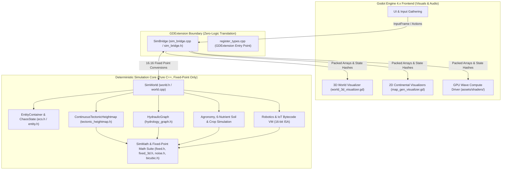

# ExoFarm Engine: Complete Architecture & Codebase Guide

Welcome to the comprehensive technical documentation for **ExoFarm**, a high-performance deterministic simulation engine written in modern C++ and integrated with Godot 4.x via GDExtension.

ExoFarm is built for complex, lockstep-deterministic ecological simulation, continuous plate-tectonic world generation, closed-loop hydrology, multi-nutrient agricultural biochemistry, and programmable robotic automation.

---

## 1. Documentation Index

The documentation is organized into modular deep-dive guides:

| Document | Key Topics Covered |
| :--- | :--- |
| 📘 **[Deterministic Mathematics Engine](file:///E:/exofarm/exofarm/docs/DETERMINISTIC_MATH.md)** | 16.16 fixed-point math, integer square roots, Bhaskara I rational trigonometry, 3D vectors & quaternions, multi-frequency noise suite, Catmull-Rom bicubic interpolation. |
| 🌍 **[Continuous Tectonic World Generation](file:///E:/exofarm/exofarm/docs/TECTONIC_WORLDGEN.md)** | Mitchell's best-candidate plate sampling, fractal domain warping, Voronoi bisector hyperplanes, 7 geodynamic boundary regimes (orogeny, subduction, rifting), Whittaker biomes, orographic moisture, mineral genesis. |
| 💧 **[Hydrology, Agronomy & Ecology](file:///E:/exofarm/exofarm/docs/HYDROLOGY_AND_AGRONOMY.md)** | Closed-loop hydraulic graph (reservoirs & river reaches), pump parasitism & drought cascades, 6-nutrient soil chemistry (NPK + CaMgS), crop genetics & affixes, irrigation plumbing, carbon cycle & weather hazards, chunk LOD. |
| 🤖 **[ECS, Robotics & IoT Virtual Machine](file:///E:/exofarm/exofarm/docs/AUTOMATION_AND_ECS.md)** | Data-oriented Structure-of-Arrays (SoA) ECS (`ChaosState`), mobile robots (humanoid, drone, combine), stationary IoT microcontroller VM with custom 16-bit ISA, monotonic replay tapes, 64-bit state hashing. |
| 🖥️ **[GDExtension & GPU Wave Cages](file:///E:/exofarm/exofarm/docs/GDEXTENSION_AND_RENDERING.md)** | `SimBridge` translation layer, zero-copy buffer marshaling, Jeschke et al. 2020 boundary-aware wave cages via GPU Jump Flooding Algorithm, spatial water shaders, 2D and 3D frontend visualizers. |
| 🧪 **[Headless Verification & Testing](file:///E:/exofarm/exofarm/docs/VERIFICATION_AND_TESTING.md)** | Standalone headless test suite (`test_determinism`, `test_hydrology`, `test_tectonics`, `test_biomes`), 500-tick lockstep replay verification, topological cycle detection, SCons build system. |

---

## 2. Architectural Blueprint

The engine is architected around strict separation of concerns:



---

## 3. Directory & File Sitemap

```
E:/exofarm/exofarm/
├── docs/                                  # Complete Technical Documentation Suite
│   ├── README.md                          # Master Engine Overview & Sitemap (this file)
│   ├── DETERMINISTIC_MATH.md              # 16.16 fixed-point math, trig, noise & bicubic
│   ├── TECTONIC_WORLDGEN.md               # Geodynamics, Voronoi plates, biomes & minerals
│   ├── HYDROLOGY_AND_AGRONOMY.md          # Hydraulic graph, 6-nutrient soil, crops & weather
│   ├── AUTOMATION_AND_ECS.md              # SoA ECS, mobile robotics, IoT VM & rollback
│   ├── GDEXTENSION_AND_RENDERING.md       # GDExtension, Jeschke wave cages & visualizers
│   └── VERIFICATION_AND_TESTING.md        # Headless testing harnesses & SCons build
│
├── src/                                   # Engine C++ Source Tree
│   ├── core/                              # Core simulation systems
│   │   ├── ecs.h                          # EntityContainer SoA memory manager & ID maps
│   │   ├── entity.h                       # Entity structures, ChaosState, CropAffixes, BotState
│   │   ├── input.h                        # InputFrame discriminated union & action bitmasks
│   │   ├── hydrology_graph.h              # ReservoirNode, RiverBelt, HydraulicGraph network
│   │   ├── tectonic_heightmap.h           # ContinuousTectonicHeightmap & geodynamic physics
│   │   ├── tile_registry.h                # Binary room blueprint and tile anchor loader
│   │   ├── item.h / item.cpp              # ItemData & procedural deterministic affix generator
│   │   └── world.h / world.cpp            # SimWorld master simulation coordinator
│   │
│   ├── math/                              # Deterministic mathematical primitives
│   │   ├── fixed.h                        # 16.16 fixed-point arithmetic, sqrt, inv_sqrt
│   │   ├── fixed_3d.h                     # Bhaskara I sin/cos, Vec3Fixed, QuatFixed
│   │   ├── noise.h                        # hash2d, quintic_smooth, gradient noise, fBm, ridge
│   │   ├── rng.h                          # SplitMix64 pseudo-random number generator
│   │   └── bicubic.h                      # Catmull-Rom cubic splines & 2D surface sampling
│   │
│   ├── entities/                          # Entity logic controllers
│   │   └── player.h / player.cpp          # Deterministic Player movement, terrain drag, controls
│   │
│   ├── gdextension/                       # Godot C++ GDExtension binding layer
│   │   ├── register_types.h / .cpp        # GDExtension module registration
│   │   └── sim_bridge.h / sim_bridge.cpp  # SimBridge node exposing SimWorld to Godot
│   │
│   └── tests/                             # Unit tests
│       └── test_fixed_3d.cpp              # Trigonometry and quaternion precision check
│
├── assets/shaders/                        # GPU Compute & Rendering Assets
│   ├── wave_cage_baker.gd / .glsl         # GPU Jump Flooding Algorithm (JFA) distance baker
│   ├── wave_compute_driver.gd / .glsl     # Real-time boundary-aware Gerstner compute driver
│   └── wave_water.gdshader                # Spatial water surface shader with foam blending
│
├── test_determinism.cpp                   # Standalone 500-tick lockstep replay verification tool
├── test_hydrology.cpp                     # Standalone hydraulic graph & river topology analyzer
├── test_tectonics.cpp                     # Standalone continuous tectonic geodynamics tester
├── test_biomes.cpp                        # Headless Whittaker biome distribution analyzer
├── world_3d_visualizer.gd / .tscn         # Interactive 3D terrain and real-time wave visualizer
├── map_gen_visualizer.gd / .tscn          # 2D multi-layer continental map generator visualizer
├── river_micro_visualizer.gd / .tscn      # Ground-level micro river and flow direction visualizer
└── SConstruct                             # SCons build script for MSVC, Clang, GCC & headless tools
```

---

## 4. Key Systems & Code Symbols Reference

### 4.1 Deterministic Mathematics
- [`ONE`](file:///E:/exofarm/exofarm/src/math/fixed.h#L11): $65536$ ($1.0$ in 16.16).
- [`mul_fixed`](file:///E:/exofarm/exofarm/src/math/fixed.h#L17), [`div_fixed`](file:///E:/exofarm/exofarm/src/math/fixed.h#L18): Arithmetic operations with 64-bit precision preservation.
- [`sqrt_fixed`](file:///E:/exofarm/exofarm/src/math/fixed.h#L29-L59): Integer binary-search square root with 2 Newton-Raphson iterations.
- [`inv_sqrt_fixed`](file:///E:/exofarm/exofarm/src/math/fixed.h#L65-L82): Pure-integer inverse square root with Newton-Raphson refinement.
- [`sin_fixed`](file:///E:/exofarm/exofarm/src/math/fixed_3d.h#L22-L26), [`cos_fixed`](file:///E:/exofarm/exofarm/src/math/fixed_3d.h#L28-L30): Bhaskara I rational polynomial sine approximation.
- [`Vec3Fixed`](file:///E:/exofarm/exofarm/src/math/fixed_3d.h#L34-L71), [`QuatFixed`](file:///E:/exofarm/exofarm/src/math/fixed_3d.h#L75-L129): Fixed-point 3D vector and quaternion rotation math.
- [`SimMath::hash2d`](file:///E:/exofarm/exofarm/src/math/noise.h#L10-L16): 64-bit integer mixing hash.
- [`SimMath::fbm2d`](file:///E:/exofarm/exofarm/src/math/noise.h#L79-L102), [`SimMath::ridge_noise2d`](file:///E:/exofarm/exofarm/src/math/noise.h#L105-L134): Multi-octave Fractal Brownian Motion and alpine ridge noise.
- [`SimMath::bicubic_sample_2d`](file:///E:/exofarm/exofarm/src/math/bicubic.h#L46-L88): Catmull-Rom $C^1$ continuous 2D surface evaluation.
- [`SplitMix64`](file:///E:/exofarm/exofarm/src/math/rng.h#L5-L24): 64-bit pseudo-random number generator.

### 4.2 Tectonics & World Generation
- [`Tectonics::ContinuousTectonicHeightmap`](file:///E:/exofarm/exofarm/src/core/tectonic_heightmap.h#L117-L711): Continuous plate heightmap generator.
- [`Tectonics::TectonicNode`](file:///E:/exofarm/exofarm/src/core/tectonic_heightmap.h#L75-L86): Plate control node with drift velocity, crust thickness, and density.
- [`Tectonics::TectonicSample`](file:///E:/exofarm/exofarm/src/core/tectonic_heightmap.h#L89-L114): Complete geological query diagnostic structure.
- [`Tectonics::BoundaryType`](file:///E:/exofarm/exofarm/src/core/tectonic_heightmap.h#L64-L72): Himalayan collision, subduction trench/arc, rifting, shear faulting.

### 4.3 Hydrology, Soil & Agriculture
- [`Hydrology::HydraulicGraph`](file:///E:/exofarm/exofarm/src/core/hydrology_graph.h#L64-L410): Closed-loop directed graph network of reservoirs and river reaches.
- [`Hydrology::ReservoirNode`](file:///E:/exofarm/exofarm/src/core/hydrology_graph.h#L13-L34): Stored water bodies (lakes, ponds, aquifers, oceans).
- [`Hydrology::RiverBelt`](file:///E:/exofarm/exofarm/src/core/hydrology_graph.h#L36-L60): River reaches with flow throughput, pump extractions, and water levels.
- [`CropImplicit`](file:///E:/exofarm/exofarm/src/core/entity.h#L43-L50), [`CropPrefix`](file:///E:/exofarm/exofarm/src/core/entity.h#L52-L60), [`CropSuffix`](file:///E:/exofarm/exofarm/src/core/entity.h#L62-L70): Modular genetic crop affixes.
- [`StructureType`](file:///E:/exofarm/exofarm/src/core/entity.h#L72-L80): Well, Pump, Channel, Sprinkler, Pivot, Bridge.
- [`WeatherState`](file:///E:/exofarm/exofarm/src/core/world.h#L15-L21): Clear, Rain, Acid Rain, Storm, Flood.

### 4.4 ECS, Automation & Architecture
- [`EntityContainer`](file:///E:/exofarm/exofarm/src/core/ecs.h#L14-L218): Dense parallel SoA entity allocator with swap-and-pop $O(1)$ removal.
- [`ChaosState`](file:///E:/exofarm/exofarm/src/core/entity.h#L199-L263): High-performance parallel vectors for hot physics and collision data.
- [`BotState`](file:///E:/exofarm/exofarm/src/core/entity.h#L89-L125): State for humanoid, drone, combine, and IoT microcontroller bots.
- [`InputFrame`](file:///E:/exofarm/exofarm/src/core/input.h#L6-L61): Packed binary input record for lockstep replay.
- [`BisectSnapshot`](file:///E:/exofarm/exofarm/src/core/entity.h#L266-L325): Complete state snapshot for zero-loss rollback.
- [`SimWorld`](file:///E:/exofarm/exofarm/src/core/world.h#L86-L359): Master simulation coordinator.
- [`SimBridge`](file:///E:/exofarm/exofarm/src/gdextension/sim_bridge.h#L14-L138): Godot 4.x GDExtension bridge node.

---

## 5. Quick Build & Run Guide

### 5.1 Prerequisites
- **SCons** (Python 3.8+)
- **C++ Compiler**: MSVC (Visual Studio 2022) on Windows, or GCC / Clang on Linux/macOS.
- **Godot 4.3+** for graphical visualizers.

### 5.2 Build Commands
```powershell
# 1. Build the GDExtension shared library
scons platform=windows

# 2. Build and run the lockstep determinism verification suite
scons platform=windows test
./bin/test_determinism.exe

# 3. Build and run the hydrology graph and river topology analyzer
scons platform=windows hydrology
./bin/test_hydrology.exe

# 4. Build and run the continuous tectonic heightmap test suite
scons platform=windows tectonics
./bin/test_tectonics.exe
```

### 5.3 Launching Visualizers in Godot
Open the project directory in the Godot 4.x editor and launch any of the test scenes:
- `world_3d_visualizer.tscn`: 3D interactive terrain, plate vectors, and GPU wave cages.
- `map_gen_visualizer.tscn`: 2D full-world continental map generator and layer inspector.
- `river_micro_visualizer.tscn`: Ground-level micro river currents and drought diagnostic tool.
