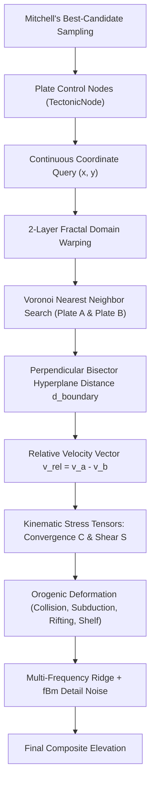
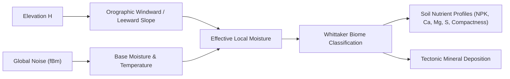

# Continuous Voronoi Tectonic World Generation

This document details the tectonic heightmap generation, continuous geodynamics, Whittaker biome synthesis, and geological mineral deposition in the ExoFarm engine.

All tectonic heightfield generation logic is implemented in [`src/core/tectonic_heightmap.h`](file:///E:/exofarm/exofarm/src/core/tectonic_heightmap.h), and integrated into the global simulation environment in [`src/core/world.cpp`](file:///E:/exofarm/exofarm/src/core/world.cpp#L580-L830).

---

## 1. Geological Geodynamics & Plate Simulation

Rather than using simple Perlin noise overlays (which produce uniform, unphysical blobs), ExoFarm implements a continuous, physical geodynamic simulation inspired by plate tectonics:



### 1.1 Tectonic Plate Representation ([`TectonicNode`](file:///E:/exofarm/exofarm/src/core/tectonic_heightmap.h#L75-L86))

Each lithospheric plate is parameterized as a control node:
```cpp
struct TectonicNode {
    uint32_t id;
    Vec2Fixed position;        // World coordinates (16.16)
    Vec2Fixed velocity;        // Drift velocity vector (16.16)
    PlateType plate_type;      // CONTINENTAL, OCEANIC, ISLAND_ARC
    int64_t base_elevation;    // Macro crust elevation (16.16)
    int64_t crust_thickness;   // Lithosphere thickness (affects deformation width)
    int64_t crust_rigidity;    // Flexural rigidity (affects fold wavelength)
    int64_t density;           // Density (e.g. 2700 cont vs 3000 oceanic)
    int64_t roughness;         // Meso-scale roughness multiplier
};
```

### 1.2 Mitchell's Best-Candidate Plate Distribution

To prevent unnatural clustering of plate centers while avoiding the artificial regularity of strict grid distribution, the engine uses **Mitchell's Best-Candidate Algorithm** ([`generate_control_nodes`](file:///E:/exofarm/exofarm/src/core/tectonic_heightmap.h#L204-L326)):
1. Plate 0 is placed near the world center with a continental bias to guarantee an accessible starter landmass for the player.
2. For each subsequent plate $i \in [1, N-1]$, $k$ candidate positions are sampled uniformly at random across the map.
3. The candidate that maximizes the minimum squared Euclidean distance to all previously placed plates is selected:
   $$\text{cand}^* = \arg\max_{c \in C} \min_{p \in P} \|c - p\|^2$$
4. 8 surrounding buffer oceanic plates are positioned beyond the world boundary (4 midpoints and 4 corners), guaranteeing that all continental landmasses terminate in open ocean.

---

## 2. Continuous Spatial Query & Kinematic Tensor Analysis

A query at world coordinates $(x, y)$ returns full geological diagnostics encapsulated in [`TectonicSample`](file:///E:/exofarm/exofarm/src/core/tectonic_heightmap.h#L89-L114):

### 2.1 Two-Layer Domain Warping ([`warp_coordinate`](file:///E:/exofarm/exofarm/src/core/tectonic_heightmap.h#L332-L350))
Before finding Voronoi cell boundaries, coordinates are warped through two octaves of Fractal Brownian Motion. This turns what would otherwise be straight polygonal Voronoi boundary lines into fractal, organic coastlines:
$$q_x = \text{fBm}_4(x \cdot \omega + 123, y \cdot \omega + 456)$$
$$q_y = \text{fBm}_4(x \cdot \omega + 789, y \cdot \omega + 321)$$
$$p_{\text{warped}} = p + \text{warp\_scale} \cdot (q_x, q_y)$$

### 2.2 Voronoi Bisector Hyperplane Distance
The query identifies the closest plate centroid $A$ and the second closest plate centroid $B$.
The separation vector between the two nodes is $D_{AB} = B - A$ with unit normal $\hat{n} = D_{AB} / \|D_{AB}\|$.

The exact perpendicular Euclidean distance $d_{\text{boundary}}$ from $P$ to the bisector hyperplane is evaluated in fixed-point without square roots on the separation:
$$d_{\text{boundary}} = \frac{\|P - B\|^2 - \|P - A\|^2}{2 \cdot \|B - A\|}$$

### 2.3 Kinematic Strain & Boundary Classification
The relative velocity between the two drifting plates is:
$$v_{\text{rel}} = v_A - v_B$$
From $v_{\text{rel}}$, we project the normal and tangential stress components:
- **Convergence Rate ($C$)**:
  $$C = v_{\text{rel}} \cdot \hat{n}$$
  $C > 0$: Plates are colliding (Convergent).
  $C < 0$: Plates are pulling apart (Divergent).
- **Shear Rate ($S$)**:
  $$S = |v_{\text{rel}} \cdot \hat{t}|$$
  Measures lateral strike-slip motion along the boundary.

---

## 3. The 7 Geodynamic Boundary Regimes

[`calculate_tectonic_deformation`](file:///E:/exofarm/exofarm/src/core/tectonic_heightmap.h#L525-L665) evaluates the topographic uplift or subsidence $\Delta H_{\text{tectonic}}$:

| Boundary Type | Geological Analogue | Conditions | Topographic Response |
| :--- | :--- | :--- | :--- |
| **Convergent Continental Collision** | Himalayas | $C > C_{\text{threshold}}$, Cont + Cont | Mountain fold belts with Biot buckling harmonics $\lambda_{\text{fold}}$ |
| **Convergent Subduction** | Andes / Cascades | $C > C_{\text{threshold}}$, Cont + Ocean | Deep oceanic trench offshore + coastal volcanic cordillera arc inland |
| **Island Arc Subduction** | Mariana / Aleutian | $C > C_{\text{threshold}}$, Ocean + Ocean | Deep abyssal trench |
| **Divergent Continental Rift** | East African Rift | $C < -C_{\text{threshold}}$, Cont + Cont | Central graben valley depression flanked by uplifted horst shoulders |
| **Divergent Oceanic Spreading** | Mid-Atlantic Ridge | $C < -C_{\text{threshold}}$, Ocean + Ocean | Submerged bathymetric ridge with central axial rift |
| **Transform Shear Fault** | San Andreas Fault | $S > 3000$ | Steep lateral scarp along fault line |
| **Passive Interior Margin** | Continental Interior | $C \approx 0, S \approx 0$ | Smooth quintic blend to baseline crust elevation |

### 3.1 Strike-Aligned Orogeny & Fold Belts
When two continental plates collide, folding follows an organic, strike-aligned geodynamic model:
1. **Along-Strike Modulation**: Multi-frequency harmonic variation along the boundary tangent $\hat{t}$ creates distinct mountain massifs and peaks alternating with mountain passes, saddles, and transverse water gaps.
2. **Oblique En Echelon Folding**: Folds are angled obliquely across the boundary:
   $$\text{phase} = \frac{2\pi \cdot d_{\text{boundary}}}{\lambda_{\text{fold}}} + \frac{\text{strike\_coord}}{4 \cdot \lambda_{\text{fold}}}$$
3. **Anisotropic Alpine Ridges**: Ridge noise in deformation zones is aligned with the tectonic strike, forming razor-sharp ridgelines with lateral spurs descending into valleys.

### 3.2 Discrete Volcanic Chains in Subduction
Subduction volcanic cordilleras are modeled as discrete stratovolcano cones spaced along the volcanic front ($\sim 36\text{m}$ spacing), connected by lower volcanic saddles. Offshore, the subducting plate plunges smoothly into an abyssal subduction trench.

### 3.3 Voronoi Triple-Junction Blending & Seamless Littoral Beach
To completely eliminate Voronoi seam cliffs (e.g. 60m vertical drops where neighbor selection abruptly switches between divergent/convergent plates):
1. **3-Neighbor Triple-Junction Blending**: `SpatialGrid::query_three_nearest()` identifies the three closest plate centroids ($A, B, C$). When the difference in distance $\delta = d(P, C) - d(P, B)$ is small ($\delta < W_{\text{blend}}$), boundary deformation and baseline elevation are smoothly blended across the medial bisector via quintic smoothing, ensuring $C^1$ continuity and eliminating vertical cliff artifacts without requiring raster blur passes.
2. **Seamless Coastline Elevation ($d=0$)**:
   - At the continental-oceanic boundary ($d = 0$), baseline elevation and subduction deformation converge to **exactly $0.0\text{m}$** (sea level) on both sides.
   - **Land side ($d \ge 0$)**: Climbs gently from $0.0\text{m}$ at the waterline up to $+2.5\text{m}$ (beach crest) across a walkable sandy beach, then smoothly transitions inland into continental lowlands ($+26\text{m}$).
   - **Oceanic side ($d < 0$)**: Descends from $0.0\text{m}$ to $-2.0\text{m}$ (shallow surf), across the continental shelf ($-8\text{m}$), down the continental slope to deep abyssal plains ($-36\text{m}$).
3. **Dynamic Littoral Noise Attenuation**: High-amplitude detail noise is smoothly attenuated near the waterline ($|z| < 6\text{m}$), preserving natural micro-relief and gentle sand dunes while preventing steep coastal walls.

---

## 4. Climate, Biomes, and Soil Genesis ([`world.cpp`](file:///E:/exofarm/exofarm/src/core/world.cpp#L580-L830))

Once the tectonic heightfield $H(x, y)$ is established, the engine couples it to a simulated climate system:



### 4.1 Orographic Precipitation & Rain Shadow
Wind is modeled blowing west-to-east ($+x$). By sampling the elevation delta over a horizontal step $\Delta x$:
$$\Delta H_{\text{slope}} = H(x, y) - H(x - \text{cell\_size}, y)$$
- **Ascending slope ($\Delta H > 0$)**: Air rises and cools, causing orographic precipitation (+moisture).
- **Descending slope ($\Delta H < 0$)**: Air descends and warms, forming an arid rain shadow (-moisture).

### 4.2 Whittaker Biome Distribution
Biomes are assigned using a discrete temperature-moisture phase space:

| Biome ID | Name | Elevation ($H$) | Moisture | Temperature | Surface Type |
| :---: | :--- | :--- | :--- | :--- | :--- |
| `0` | **Ocean** | $H \le 0$ | Any | Any | `WATER_DEEP` |
| `8` | **Beach / Coast** | $0 < H \le 3\text{m}$ | Any | Any | `MUD_BANK` / Sand |
| `7` | **Mountain** | $H > 48\text{m}$ | Any | Any | `ROCK_CLIFF` |
| `1` | **Tundra / Glacier** | $3\text{m} < H \le 48\text{m}$ | Any | Cold ($T < -16000$) | Frozen Soil |
| `2` | **Desert** | $3\text{m} < H \le 48\text{m}$ | Dry ($M < -14000$) | Hot/Moderate | `DRY_SOIL` / Sand |
| `3` | **Grassland** | $3\text{m} < H \le 48\text{m}$ | Moderate | Moderate | `DRY_SOIL` / Grass |
| `4` | **Forest** | $3\text{m} < H \le 48\text{m}$ | High ($M > 8000$) | Moderate | `TILLED_SOIL` / Rich Loam |
| `5` | **Tropical Rainforest** | $3\text{m} < H \le 48\text{m}$ | Very High ($M > 24000$) | Hot ($T > 10000$) | High humus |
| `6` | **Swamp / Wetlands** | $3\text{m} < H \le 8\text{m}$ | High ($M > 4000$) | Moderate/Warm | `MUD_BANK` |

### 4.3 Soil Nutrient Genesis
Every land cell is initialized with physical and chemical soil properties derived from its biome and slope:
- **Compactness**: Base compactness $30 \cdot \text{ONE} + \text{clamp}(2 \cdot |\Delta H_{\text{slope}}|, 0, 30 \cdot \text{ONE})$. Steeper terrain has thin, compacted, rocky soil.
- **Macronutrients (N-P-K)** and **Secondary Nutrients (Ca-Mg-S)**:
  - *Forest / Rainforest*: Abundant Nitrogen ($140..250$ PPM) from leaf litter; high Phosphorus in forests, leached in rainforests.
  - *Grassland*: Balanced NPK with low compactness ($25..60\%$). Ideal for beginner farming.
  - *Swamp*: Anaerobic sulfur accumulation ($50$ PPM); very low compactness ($10..35\%$).
  - *Desert / Mountains*: Calcareous soils rich in Calcium ($80..90$ PPM) and Potassium from rock weathering, but deficient in Nitrogen ($20..30$ PPM).

### 4.4 Geological Mineral Deposition
Tectonic context determines ore vein placement across land tiles ($\approx 18\%$ spawn chance via `hash2d`):
- **Orogenic Collision Belts**: Metamorphic granite (`7`) and deep iron veins (`2`).
- **Subduction Volcanic Arcs**: Native sulfur (`6`), hydrothermal copper porphyry (`3`), and magnetite iron ore (`2`).
- **Continental Rift Basins**: Evaporites and agricultural limestone (`4`).
- **Stable Continental Interiors**: Swamp coal seams (`5`), quartz silica (`1`), and sedimentary iron (`2`).
