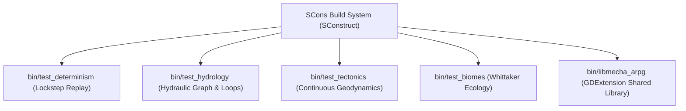

# Headless Verification & Testing Suite

This document covers the standalone headless testing harnesses, determinism verification pipelines, topological analyzers, and SCons build system configurations in ExoFarm.

All test sources are located in the project root (`test_*.cpp`) and [`src/tests/`](file:///E:/exofarm/exofarm/src/tests). The SCons build configuration is defined in [`SConstruct`](file:///E:/exofarm/exofarm/SConstruct).

---

## 1. Overview of Test Targets

ExoFarm provides dedicated headless test executables that compile without any Godot Engine dependencies using the preprocessor definition `-DSIM_HEADLESS`:



| Executable Target | SCons Alias | Source File | Primary Purpose |
| :--- | :---: | :--- | :--- |
| **`test_determinism`** | `test` | [`test_determinism.cpp`](file:///E:/exofarm/exofarm/test_determinism.cpp) | Validates 500-tick lockstep bit-level replay and snapshot rollback equality |
| **`test_hydrology`** | `hydrology` | [`test_hydrology.cpp`](file:///E:/exofarm/exofarm/test_hydrology.cpp) | Tests pump parasitism, reach starvation cascades, and river network topology |
| **`test_tectonics`** | `tectonics` | [`test_tectonics.cpp`](file:///E:/exofarm/exofarm/test_tectonics.cpp) | Validates continuous sub-pixel sampling, orogeny, rifting, and subduction |
| **`test_biomes`** | `biomes` | [`test_biomes.cpp`](file:///E:/exofarm/exofarm/test_biomes.cpp) | Analyzes biome area percentages and land-to-ocean ratios across seeds |
| **`test_fixed_3d`** | - | [`src/tests/test_fixed_3d.cpp`](file:///E:/exofarm/exofarm/src/tests/test_fixed_3d.cpp) | Compares Bhaskara I sine/cosine against `math.h` doubles and tests quaternions |

---

## 2. Lockstep Determinism Verification ([`test_determinism.cpp`](file:///E:/exofarm/exofarm/test_determinism.cpp))

Lockstep simulation requires that identical inputs applied to identical initial states produce identical outputs across all platforms and time steps.

### 2.1 The Verification Protocol
1. **World Generation**: A $64 \times 64$ world is generated with seed $42$.
2. **Entity Instantiation**: A player, 200 roaming enemies, 50 multi-trait crops, structures (well, pump, sprinkler, bridge), and automation bots (humanoid, drone, IoT microcontroller) are spawned.
3. **Snapshot Baseline**: An initial [`BisectSnapshot`](file:///E:/exofarm/exofarm/src/core/entity.h#L266-L325) is captured and its 64-bit state hash recorded.
4. **Execution Recording**: 500 ticks of pseudo-random gameplay inputs (movements, combat actions, equipment swaps) are simulated. On each tick, the input frame and the post-tick state hash are appended to a reference tape:
   $$\text{Tape} = [(\text{Input}_0, \text{Hash}_0), (\text{Input}_1, \text{Hash}_1), \dots, (\text{Input}_{499}, \text{Hash}_{499})]$$
5. **State Restoration**: A fresh `SimWorld` instance is created and restored to the initial snapshot.
6. **Tick-by-Tick Replay**: The recorded input frames are fed sequentially into the restored instance. Every single replayed tick's hash is compared against the reference hash.
7. **Divergence Analysis** ([`compare_snapshots`](file:///E:/exofarm/exofarm/test_determinism.cpp#L39-L141)): If any hash differs by even a single bit, execution halts immediately and prints a field-by-field divergence report identifying the exact entity ID, coordinate, soil nutrient, or PRNG seed that diverged.

---

## 3. Hydrology Network & Topology Suite ([`test_hydrology.cpp`](file:///E:/exofarm/exofarm/test_hydrology.cpp))

The hydrology suite verifies both mathematical flow dynamics and procedural graph generation:

### 3.1 Direct Hydraulic Pipe & Reservoir Tests
- **Flow Capacity**: Verifies that a pipe consisting of $N$ tiles provides an initial flow capacity of $N \times 10.0$ units/tick.
- **Pump Parasitism**: Validates that placing a pump on a river tile extracts water from that pipe's throughput while leaving the upstream reservoir's extraction rate untouched.
- **Over-Pumping & Desiccation**: Increases pump extraction beyond reach capacity ($90.0 \ge 80.0$). Verifies that `flow_rate` drops to $0$, `water_level` drops to $0\%$, `is_dry` becomes `true`, and downstream reservoirs receive $0$ inflow.
- **Pump Removal**: Verifies that removing pumps instantly restores pipe water levels to $100\%$ and resumes downstream discharge.

### 3.2 Cascading Reach Starvation
Sets up a multi-segment cascade:
$$\text{Lake A} \xrightarrow{\text{Pipe 1 (Cap 100.0)}} \text{Pipe 2 (Cap 60.0)} \rightarrow \text{Lake B}$$
Over-pumping the upstream Pipe 1 starving Pipe 2 and Lake B, proving that drought conditions correctly cascade down hydrological networks.

### 3.3 Graph Topology Validation (Cycle & Dead-End Detection)
[`test_map_gen_river_topology`](file:///E:/exofarm/exofarm/test_hydrology.cpp#L198-L292) iterates over **200 distinct world seeds** ($256 \times 144$ grid) to rigorously test procedural river generation:
- Traces flow target pointers from every river tile downhill to verify that no river reaches form closed circular loops ($\text{Cycle} = 0$).
- Verifies that all rivers successfully terminate in a depression lake or the ocean without dead-ending on a mountain ridge.

---

## 4. Tectonic Geodynamics Test Suite ([`test_tectonics.cpp`](file:///E:/exofarm/exofarm/test_tectonics.cpp))

Validates the continuous geodynamic algorithms across synthetic transects:

1. **Sub-Pixel Spatial Continuity**: Samples elevation at $(100.5, 150.25)$ and $(100.500015, 150.25)$, asserting that elevation changes smoothly without discrete jumps ($\Delta H < 100$ fixed-point units).
2. **Continental Collision (Himalayan Orogeny)**: Places two continental plates head-on. Asserts that the boundary exhibits $C > 0$ and produces significant mountain uplift ($\Delta H_{\text{tectonic}} > 15 \cdot \text{ONE}$).
3. **Asymmetric Subduction**: Simulates an oceanic plate colliding with a continental plate. Asserts that the oceanic side experiences trench subsidence ($\Delta H < 0$) while the continental side uplifts into a volcanic cordillera ($\Delta H > 0$).
4. **Divergent Rifting (East African Analogue)**: Simulates two continental plates pulling apart. Asserts that the boundary develops a central graben depression flanked by uplifted horst shoulders.
5. **Deterministic Grid Generation**: Generates a $64 \times 32$ grid twice from scratch and verifies bit-for-bit equivalence across all elevation and plate ownership arrays. Renders an ASCII elevation preview to terminal.

---

## 5. SCons Build Pipeline ([`SConstruct`](file:///E:/exofarm/exofarm/SConstruct))

The project is built using SCons with high optimization flags tailored for deterministic game engines:

### 5.1 Compiler Flags
- **Windows (MSVC)**:
  - `/O2 /Ob2 /Oi /Ot /Oy`: Maximum speed, aggressive inlining, intrinsic expansion.
  - `/arch:AVX2`: Emits AVX2 SIMD instructions.
  - `/fp:fast`: Fast floating point (used strictly outside the deterministic simulation core).
  - `/std:c++17 /EHsc`: Modern C++ with standard exception handling.
- **Linux / macOS / GCC / Clang**:
  - `-O3 -ffast-math -mavx2 -flto=thin -std=c++20`: Profile-guided link-time optimization and modern C++20 features.

### 5.2 Building and Running Tests

To compile the GDExtension shared library and all headless test executables:

```powershell
# Compile the GDExtension shared library (bin/libmecha_arpg.dll)
scons platform=windows

# Run the 500-tick lockstep determinism test
scons platform=windows test
./bin/test_determinism.exe

# Run the hydrology graph & topology validation test
scons platform=windows hydrology
./bin/test_hydrology.exe

# Run the continuous tectonic geodynamics test
scons platform=windows tectonics
./bin/test_tectonics.exe

# Run the biome distribution analyzer
scons platform=windows biomes
./bin/test_biomes.exe
```
